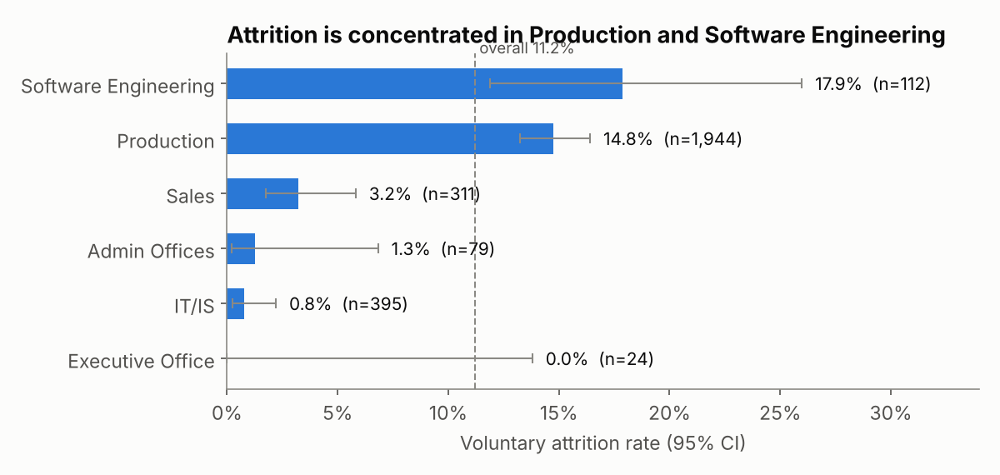
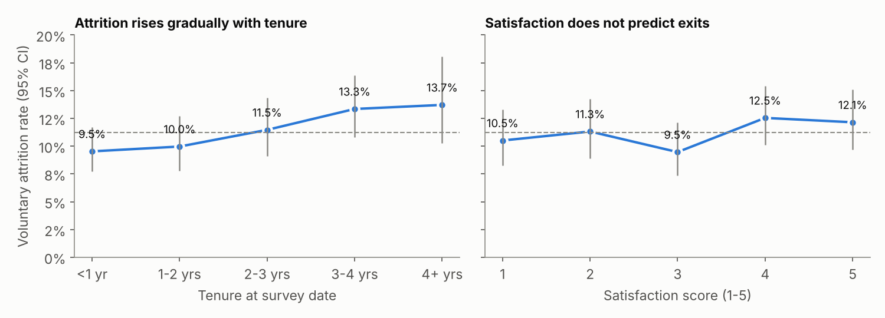
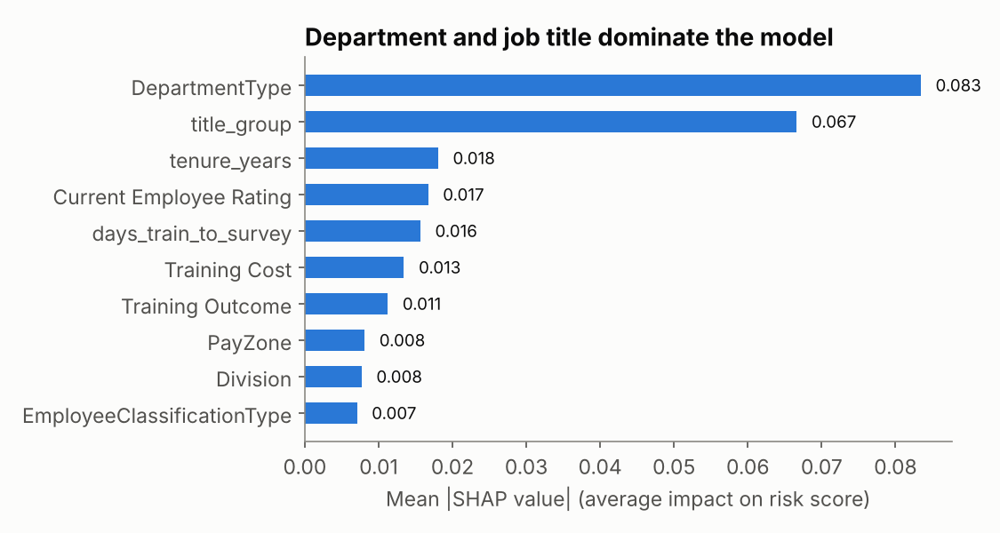
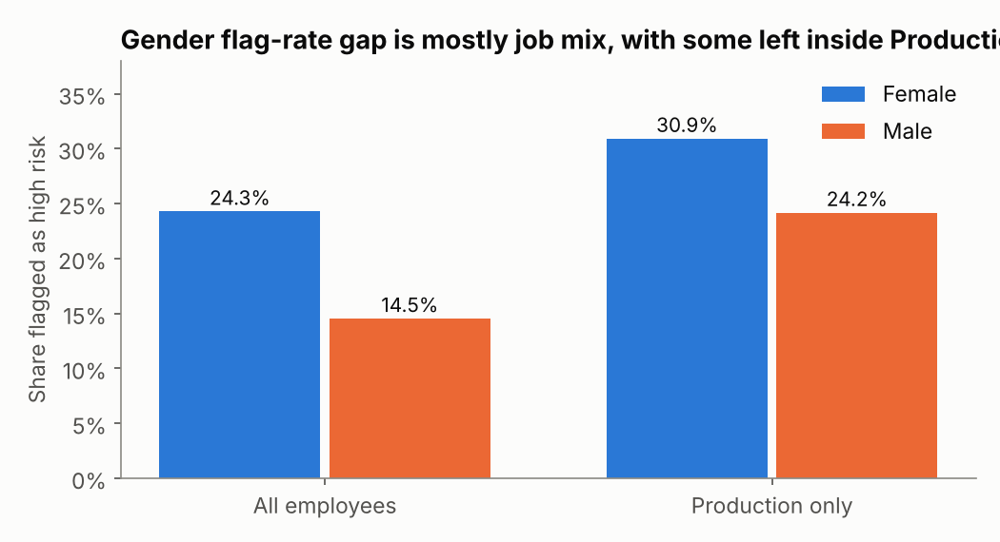

# Bias-Aware Employee Attrition Prediction

An end-to-end HR analytics project: find where voluntary attrition is concentrated, rank employees by flight risk with an explainable model, and audit that model for gender, race and age bias before anyone acts on it.

**Data:** a synthetic HR dataset (3,150 rows, 39 columns) with deliberately messy dates and contradictory fields. The method carries over to real data. The findings describe this dataset only.

## Results at a glance

| | |
|---|---|
| Cohort | 2,865 employees, 321 voluntary leavers (11.2%) |
| Model | Random forest, chosen by cross-validation over logistic regression, gradient boosting and a department-only baseline |
| Test AUC | **0.688** (95% CI 0.625-0.750) vs 0.615 for the department-only baseline |
| Top 20% flagged | catches **39%** of leavers (1.9x better than random) |
| Gender fairness | four-fifths ratio **0.886** (watch zone); race and age bands all at or above 0.94 |
| Honest caveat | removing job-structure features closes the gender gap but drops AUC to 0.52 (chance) |

## Dashboards: Retention Command Center (Tableau Public)

<!-- TODO(Angshu): replace with your published link and screenshots before committing -->
**Live dashboard:** `TODO: Tableau Public URL`

| Executive overview | HR action list | Fairness and governance |
|---|---|---|
| `TODO: dashboard/screenshots/01_executive.png` | `TODO: dashboard/screenshots/02_action_list.png` | `TODO: dashboard/screenshots/03_fairness.png` |

Build notes are in [docs/tableau_build_guide.md](docs/tableau_build_guide.md).

## Key findings

**1. Attrition is a job-family problem.** Production (14.8%, n=1,944) and Software Engineering (17.9%, n=112, small sample) are far above IT (0.8%), Sales (3.2%) and Admin (1.3%). Within Production, Technician II roles leave at 23.5% versus 12.2% for Technician I.



**2. Two popular assumptions do not hold in this data.** Attrition rises gradually with tenure (9.5% to 13.7%), with no spike in years 3 to 5. Satisfaction score has no relationship with leaving (9.5% to 12.5% across scores 1 to 5).



**3. The model's signal is mostly department and job title.** SHAP ranks them first and second by a wide margin. Inside Production, the model's ranking AUC is only 0.60, so individual-level lists are a weak prioritisation aid. Team-level hotspots are the strongest result.



## Fairness audit

The model never sees gender, race or age. Flagged means the top 20% of out-of-fold risk scores. The EEOC four-fifths rule is applied to the favourable outcome (not being flagged), and the flag-rate ratio is shown alongside it.

| Attribute | Result |
|---|---|
| Gender | Women flagged 24.3%, men 14.5%. Four-fifths ratio 0.886 (95% bootstrap CI 0.856-0.916). Flag-rate ratio 0.60. |
| Race | Lowest four-fifths ratio 0.955 |
| Age band | Lowest four-fifths ratio 0.949 |

**Why the gender gap exists.** 76% of women work in Production versus 58% of men, and Production has the highest attrition. A smaller gap remains inside Production (30.9% vs 24.2% flagged), partly because women in Production leave more often in this data.



**Fairness versus accuracy.** Refitting without title, department, division and business unit pushes the gender ratio to 0.997 but cuts AUC from 0.705 to 0.520. The information that makes the model useful is the same information that produces the disparity. No group-specific thresholds were used, since different thresholds by gender would themselves be disparate treatment. Every flag needs human review.

## Method

1. **Audit:** removed 150 exact duplicate rows. Found `EmployeeStatus`, `ExitDate` and `TerminationType` contradicting each other (for example, 991 "Active" employees with an exit date), so only `EmployeeStatus` defines the label.
2. **Cohort and label:** label is "voluntarily terminated". Terminations for cause and future starters are excluded.
3. **Model selection:** 5-fold x 3-repeat cross-validation on an 80% training split. The 20% test set is scored once. Test intervals come from a 1,000-resample bootstrap.
4. **Scoring:** every employee gets an out-of-fold risk score from a model that never saw them. Scores are for ranking, not probabilities.
5. **Explainability:** SHAP values per fold, aggregated from one-hot columns back to the original features. Each employee's top 3 risk-increasing features become their drivers.
6. **Fairness:** audit on gender, race and age band, plus the fairness/accuracy trade-off test.

## Limitations

- Synthetic data: the relationships are simulated.
- No time window: the label means "has left", not "will leave within N months".
- Moderate signal: test AUC 0.69 with a wide interval.
- Small groups: Software Engineering and department-by-gender cells are too small for firm conclusions.
- Fairness scope: gender, race and age band only. Intersections were not tested.

## Repository structure

```
├── data/
│   └── Messy_HR_Dataset_Detailed.csv      # raw synthetic input
├── notebooks/
│   └── attrition_analysis.ipynb           # full analysis; produces everything in outputs/
├── outputs/
│   ├── tableau_*.csv                      # data behind the Tableau dashboards
│   ├── model_cv_results.csv, model_test_results.csv
│   ├── shap_global_importance.csv, fairness_accuracy_tradeoff.csv
│   ├── run_summary.json
│   └── figures/                           # charts used in this README
├── dashboard/screenshots/                 # Tableau screenshots
├── docs/tableau_build_guide.md
├── requirements.txt
└── README.md
```

## How to run

```bash
pip install -r requirements.txt
jupyter lab notebooks/attrition_analysis.ipynb   # Run All (one to two minutes)
```

The notebook is deterministic (fixed seeds) and regenerates every CSV and figure in `outputs/`.

## License

Apache-2.0
